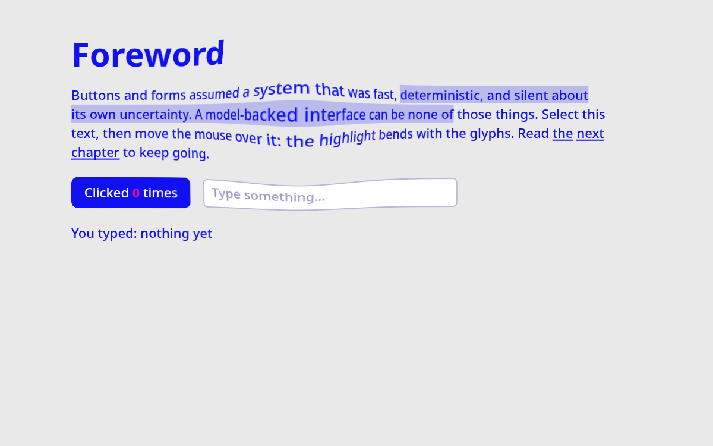

# webgl-lens1

A bubble/lens distortion over real, interactive DOM, inspired by [aiu.is](https://aiu.is/).

**Live demo:** https://magnum.github.io/webgl-lens1/ (add `#debug` to see the real HTML in red)

## How it works
- The real DOM stays on top, painted with transparent colours, so selection, clicks, focus, `:hover` and typing work normally.
- A fixed full-screen WebGL2 canvas sits behind it (`pointer-events: none`).
- Text, links, the button, the input (with caret) and the current selection (`selectionchange` + `Range.getClientRects()`) are redrawn into a 2D canvas and uploaded as a texture.
- A fragment shader samples that texture toward the mouse with a Gaussian falloff, so everything, including the selection highlight, bends inside the bubble.

## Files
- `index.html` – v2: interactive elements + distorted selection
- `v1.html` – minimal version (text only)

## Limitations
- Clicks land on the real (undistorted) position.
- Text is redrawn word by word with `fillText` (no letter-spacing, ligatures, RTL).
- Only text, links, buttons and inputs are drawn; images, textarea, select etc. would need their own code.
- Tested in Chromium only.

